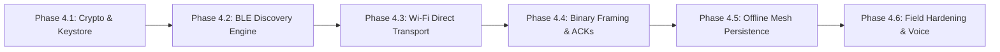

# SPIKER — Phase 4 Core Offline P2P Engine Architecture

**Status:** ARCHITECTURE READY — PENDING PHASE 4 IMPLEMENTATION  
**Document ID:** SPK-ARCH-001  
**Classification:** Core System Architecture Specification  
**Decoupling Principle:** 100% Offline-First / Zero Cloud or Supabase Dependency  

---

## 1. Architectural Vision & Scope

SPIKER is an off-grid, peer-to-peer (P2P), ad-hoc communication protocol and application designed to provide voice, text, telemetry, and critical data exchange directly between mobile and embedded devices **without relying on cellular networks, internet gateways, satellite links, or central database infrastructure**.

While the SPIKER Web portal (`spiker-web`) and Supabase PostgreSQL instance exist exclusively for public cohort registration and partner inquiries, **the Phase 4 Communication Engine is completely decoupled from cloud backends**. The core communication engine operates autonomously in radio silence or severe electromagnetic/infrastructure collapse scenarios.

```
+-----------------------------------------------------------------------------+
|                          SPIKER CLIENT ENVIRONMENT                          |
|                                                                             |
|  +-----------------------------------------------------------------------+  |
|  |                 User Interface & Application Layer                     |  |
|  |  - Encrypted Messaging    - PTT Voice / Opus      - Tactical Map      |  |
|  +-----------------------------------------------------------------------+  |
|                                     |                                       |
|  +-----------------------------------------------------------------------+  |
|  |             Offline-First Storage & Store-and-Forward Engine          |  |
|  |  - Local SQLite / SQLCipher (AES-256)             - Priority Queue    |  |
|  |  - Peer Identity & Contact Keystore               - TTL Garbage Coll  |  |
|  +-----------------------------------------------------------------------+  |
|                                     |                                       |
|  +-----------------------------------------------------------------------+  |
|  |                      End-to-End Cryptographic Core                    |  |
|  |  - Ed25519 Identity Signatures       - X25519 Key Agreement (ECDH)    |  |
|  |  - Noise Protocol Framework (XX Handshake) - Double Ratchet / ChaCha20|  |
|  +-----------------------------------------------------------------------+  |
|                                     |                                       |
|  +-----------------------------------------------------------------------+  |
|  |                 Link-Layer Transport & Framing Manager                |  |
|  |  - Binary Frame Serialization (TLV)  - MTU Fragmentation & Reassembly |  |
|  |  - Link ACKs & Sliding Window        - Duplicate Filtering (Monotonic)|  |
|  +-----------------------------------------------------------------------+  |
|                                     |                                       |
|  +-----------------------------------------------------------------------+  |
|  |                   Physical Layer Radio Orchestrator                   |  |
|  |  - Bluetooth Low Energy (BLE 4.2 / 5.x)  - Wi-Fi Direct (P2P Group)   |  |
|  |  - Wi-Fi Aware (NAN - Android)           - Apple Multipeer Fallback   |  |
|  +-----------------------------------------------------------------------+  |
+-----------------------------------------------------------------------------+
```

---

## 2. Core Subsystems Overview

| Subsystem | Specification File | Primary Function |
| :--- | :--- | :--- |
| **Device Identity** | `DEVICE-IDENTITY.md` | Manages Ed25519/X25519 cryptographic keypairs, rotating ephemeral radio identifiers, and hardware-backed key storage (KeyStore / Secure Enclave). |
| **Device Discovery** | `DEVICE-DISCOVERY.md` | Orchestrates BLE advertising/scanning, Wi-Fi Direct discovery, and Wi-Fi Aware NAN state machines across mobile OS boundaries. |
| **Connection Management** | `CONNECTION-MANAGEMENT.md` | Enforces the 8-stage connection lifecycle, transport negotiation, group owner election, and 0-RTT session resumption. |
| **Messaging Protocol** | `MESSAGING-PROTOCOL.md` | Defines binary TLV packet framing, MTU fragmentation/reassembly, sliding window retransmission, and deduplication. |
| **Offline-First Storage** | `OFFLINE-FIRST-DESIGN.md` | Governs encrypted local SQLite persistence, epidemic delay-tolerant mesh store-and-forward routing, and TTL cleanup. |
| **Security & Threat Model** | `SECURITY-MODEL.md` | Establishes zero-trust mutual authentication, forward secrecy, post-compromise security, and radio tracking defenses. |

---

## 3. Separation of Concerns: Web Auxiliary vs. P2P Core

To prevent architectural contamination, the engineering team establishes the following strict boundaries:

1. **No Cloud Hard-Lock:** The Phase 4 P2P client binary must never import, require, or bundle `@supabase/supabase-js`, remote REST endpoints, or internet-based DNS resolvers.
2. **Local Trust Anchor:** Trust is derived strictly from public key cryptography (out-of-band QR code verification or Short Authentication Strings) rather than centralized server certificates.
3. **Data Sovereignty:** All messages, contacts, encryption keys, and radio logs exist exclusively within the host device's local encrypted sandbox.

---

## 4. Phase 4 Target Milestones



- **Phase 4.1:** Cryptographic Core (Ed25519 + X25519 + ChaCha20-Poly1305 + Noise XX).
- **Phase 4.2:** BLE Dual-Role Orchestrator (Peripheral Advertising + Central Scanning).
- **Phase 4.3:** Wi-Fi Direct P2P Group Owner Negotiation & Wi-Fi Aware Socket Bridge.
- **Phase 4.4:** Binary Framing, Packet MTU Slicing, and Reliable Selective ACK Engine.
- **Phase 4.5:** Local SQLCipher Database, Store-and-Forward Queue, and Opportunistic Relaying.
- **Phase 4.6:** Low-Bitrate Voice Streaming (Opus Codec @ 6–12 kbps) & Field Stress Testing.

